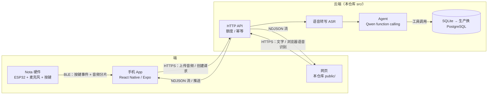
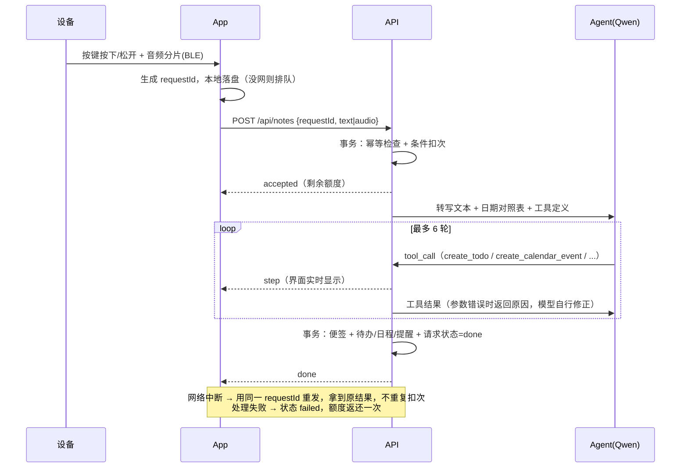

# 架构说明：网页、App、硬件三者的关系

> 本仓库实现了「网页 + 后端 + Agent + 额度」。App 与硬件为设计说明，接口已为它们预留（同一个 `POST /api/notes`）。

## 1. 整体关系

- **硬件只负责「按住录音」**：不直连云端，经手机 BLE 中转，省掉 WiFi 配网与证书管理；设备 Flash 缓存录音，手机确认收到才删除。
- **App 与网页是同一个后端的两个前端**：App 负责设备配对、录音上传与推送；网页负责查看、管理与演示。
- **网页里的「按住说话」**模拟硬件按键：浏览器录音 → `POST /api/transcribe` → 千问 ASR 转写成文字 → 用户确认后再交给 Agent。转写与 AI 处理分开计量：转写只做限流，AI 处理才扣次。

## 2. 一次按键到看到结果

## 3. 额度：为什么准确

| 风险 | 做法 |
|---|---|
| 并发超扣（先查后扣） | `BEGIN IMMEDIATE` 内执行 `UPDATE … SET used = used + 1 WHERE used < 10`，影响 0 行即拒绝 |
| 重试/重复提交重复扣次 | 客户端 `requestId` 作幂等键：已完成→返回原结果；处理中→409 |
| 失败也扣次 | 失败时 `processing → failed` 状态迁移才返还，只会返还一次 |
| 进程崩溃卡在处理中 | 启动时把超时的 `processing` 请求标记失败并返还 |
| 「一天」边界 | 按用户时区计算自然日，写入请求记录 |
| 事后怎么证明 | `quota_ledger` 流水 SUM = `daily_usage.used` = 已扣次请求数，`/api/quota/audit` 对账 |

验证：`npm run proof:quota` 起 3 个进程共用一个库做真实 HTTP 压测，见 README。

## 4. 走向生产要改什么

- SQLite → PostgreSQL（同样的条件 UPDATE + 唯一约束，无需 Redis 锁）。
- 同步处理 → 任务队列 + Worker，按「转写 / 整理」分阶段落库与重试，结果通过推送送达。
- 历史检索：关键词 → 结构化实体（人名、金额、日期）过滤 + 向量检索。
- 有副作用的工具（写日历）增加「先确认后执行」与撤销；接入真实日历需 OAuth。
- 身份：演示用请求头 `x-user-id` → 正式登录态；设备与用户的绑定见 Part A T8。
